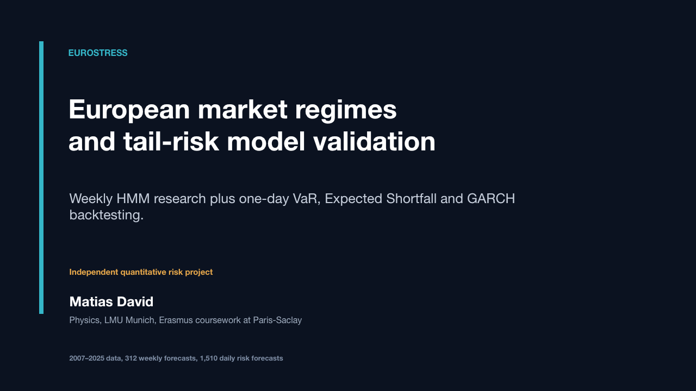
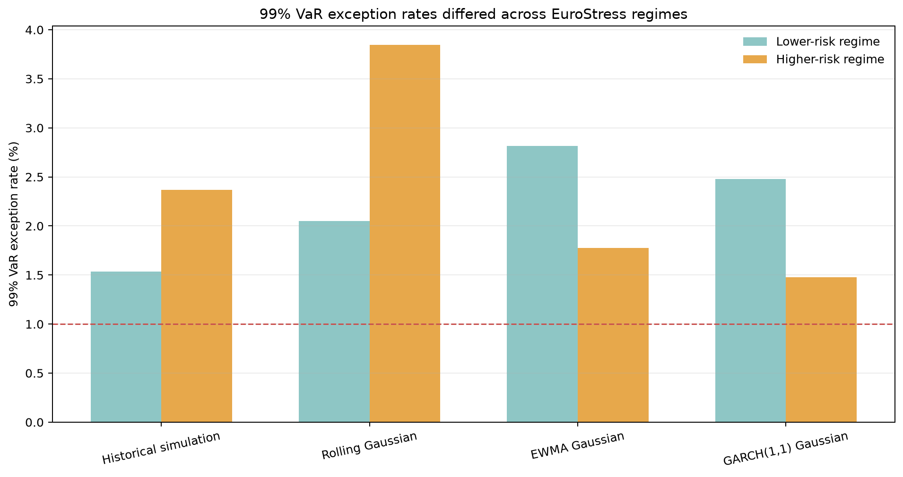
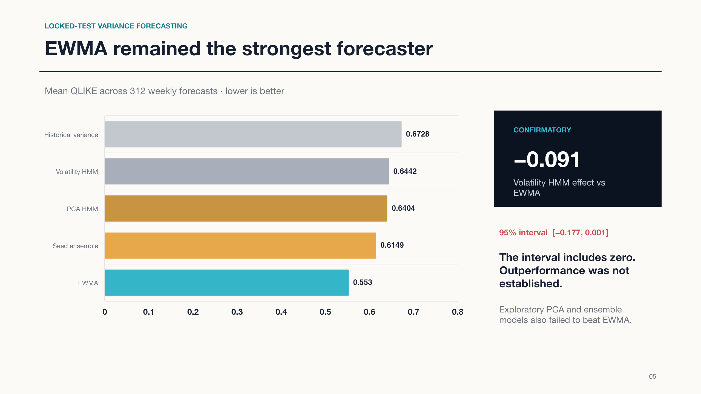
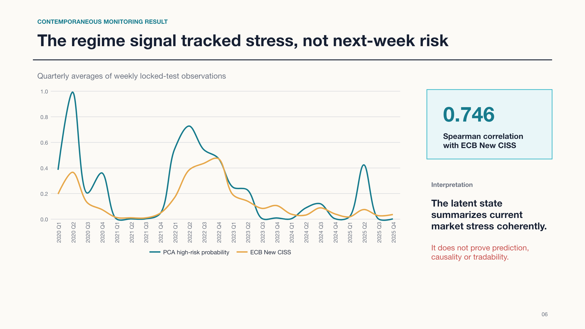
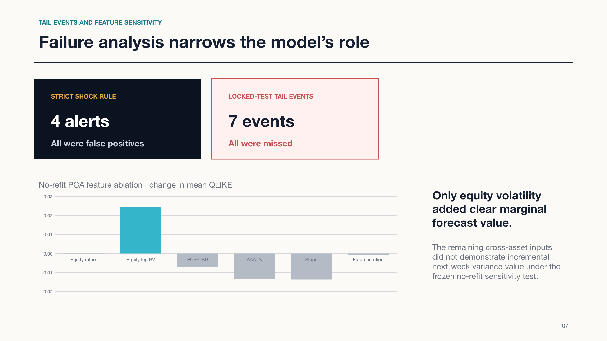
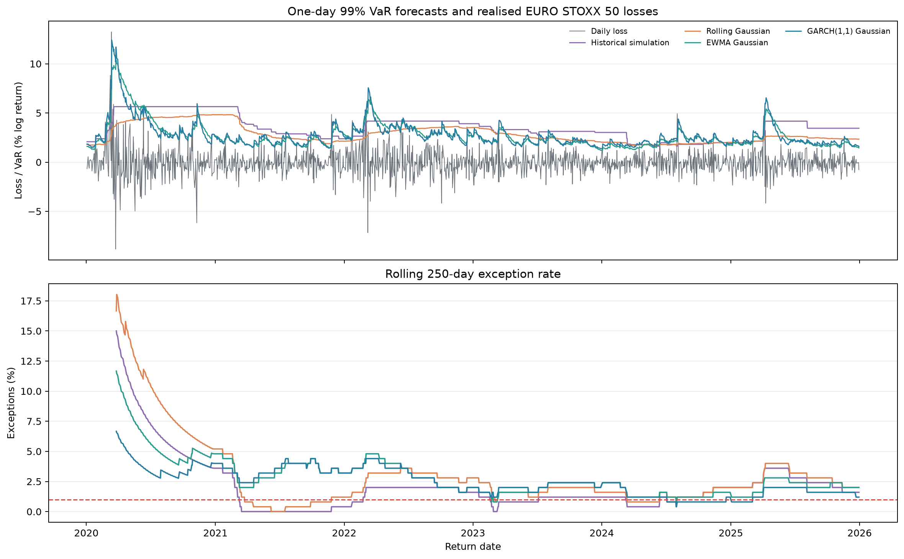

# EuroStress

**European market regimes, volatility forecasting and validation of one-day VaR and Expected Shortfall.**

EuroStress is an end-to-end quantitative risk project built on European equity, foreign-exchange, yield-curve, sovereign-fragmentation and ECB stress data from 2007 to 2025. It first tests whether latent regimes improve next-week variance forecasts, then uses those regimes to examine whether conventional daily VaR and Expected Shortfall models fail differently across market states.

The main results are deliberately not success stories. Fixed-lambda EWMA produced the lowest weekly forecast loss. In the market-risk extension, every model exceeded its intended 99% VaR exception rate; GARCH adapted faster during the COVID shock and avoided significant first-order exception clustering, but still failed unconditional coverage.



**Portfolio presentation:** [view the 14-slide PDF](reports/EuroStress_Market_Risk_Portfolio_Deck.pdf) or [download the editable PowerPoint](reports/EuroStress_Market_Risk_Portfolio_Deck.pptx).

## Result in one minute

- **Market-risk validation:** four one-day models were tested across 1,510 returns from 2020–2025 using historical simulation, rolling Gaussian, EWMA and GARCH(1,1) volatility.
- **VaR coverage:** 99% VaR produced 26–39 exceptions versus 15.1 expected; every model failed correct unconditional coverage at the 5% level.
- **Exception dynamics:** GARCH was the only model whose 99% exceptions did not show significant first-order clustering (`p = 0.794`), although its exception count remained too high.
- **Expected Shortfall:** realised losses on 97.5% VaR exception days exceeded forecast ES for every model; severity ratios ranged from 1.13 to 1.43.
- **Forecasting:** EWMA achieved the lowest mean QLIKE, 0.5530, across 312 locked-test weeks.
- **Regime models:** no HMM established an improvement over EWMA.
- **Monitoring:** the PCA high-risk-state probability had a Spearman correlation of 0.746 with ECB New CISS.





## Research questions

> Do latent European cross-asset regimes improve next-week equity-risk forecasts over simple volatility benchmarks?

> How reliable are conventional market-risk models across financial-stress regimes?

The project separates three uses of the same latent-state machinery:

1. **Variance forecasting:** does a regime-weighted forecast reduce next-week realised-variance QLIKE?
2. **Stress monitoring:** does the inferred high-risk probability align with an external systemic-stress measure?
3. **Tail-event screening:** do frozen tail probabilities or shock scores identify unusually negative next-week equity returns?

The first study was specified before the 2020–2025 test was opened. The VaR/ES module is explicitly labelled as a post-hoc extension: it adds practical model-validation work without rewriting the original result.

## Point-in-time design

| Stage | Dates | Purpose |
|---|---|---|
| Training | 30 Mar 2007–31 Dec 2015 | Fit scaling, candidate models and event thresholds |
| Validation | 1 Jan 2016–31 Dec 2019 | Apply admissibility rules and freeze candidate choices |
| Locked test | 1 Jan 2020–26 Dec 2025 | Evaluate once across 312 weekly forecasts |
| Risk-validation extension | 3 Jan 2020–30 Dec 2025 | Backtest 1,510 one-day VaR and ES forecasts |

Every model row uses a Friday information cut-off. Source dates are retained, feature scaling is fit on the training sample only, and next-week targets begin after the information date.

### Weekly feature set

- Euro-area equity return
- Log 20-day equity realised variance
- EUR/USD return
- AAA two-year yield change
- AAA 10y–2y slope change
- Sovereign-fragmentation spread change

ECB New CISS is kept outside the forecasting feature set and used as an external stress-monitoring reference.

## Models and validation design

The benchmark set contains 20-day historical variance and EWMA with fixed `lambda = 0.94`.

The original model family tested two- to four-state diagonal-covariance GMMs and HMMs across 20 deterministic initialisations. The original cross-asset HMM did not pass every frozen admissibility rule, so its confirmatory test comparison was not available.

Two branches proceeded to the locked evaluation:

- **Confirmatory secondary:** a two-state volatility-only HMM that passed the frozen rules.
- **Exploratory:** a train-only PCA HMM and an ensemble over validation-qualified seeds. These were frozen before the test was opened, but they remain labelled exploratory.

The distinction matters because stabilising a model after a failed specification does not retroactively create confirmatory evidence.

## Locked-test results

Lower QLIKE is better.

| Forecast | Mean QLIKE | Effect vs EWMA | Frozen 95% interval | Status |
|---|---:|---:|---:|---|
| EWMA | **0.5530** | — | — | Benchmark winner |
| Cross-asset seed ensemble | 0.6149 | -0.0620 | [-0.1508, 0.0373] | Exploratory |
| Cross-asset PCA HMM | 0.6404 | -0.0874 | [-0.1741, 0.0083] | Exploratory |
| Volatility-only HMM | 0.6442 | -0.0912 | [-0.1768, 0.0015] | Confirmatory secondary |
| Historical variance | 0.6728 | — | — | Benchmark |

Effects are `reference loss − candidate loss`, so a positive value favours the candidate. No HMM established an improvement over EWMA.

### Stress monitoring



The exploratory PCA model remained structurally coherent in the test period: the lower-risk state occupied 77.3% of weeks, the higher-risk state 22.7%, and their median hard-filtered durations were eight and five weeks. Its high-risk probability correlated 0.746 with New CISS.

This is contemporaneous agreement with a systemic-stress indicator. It is not evidence of prediction, causality or trading profitability.

### Tail-event and sensitivity findings



Seven locked-test weeks fell below the training fifth-percentile next-week return threshold of -5.21%. Average precision was low for every model. The strict PCA shock rule fired four times, with four false positives and seven missed events.

In a frozen no-refit ablation, removing equity realised volatility increased mean PCA-model QLIKE by 0.0246. Removing the other cross-asset inputs did not show incremental next-week variance value.

## Market-risk validation extension

The extension compares four one-day 99% VaR and 97.5% Expected Shortfall implementations:

- 250-day historical simulation;
- 250-day rolling Gaussian VaR/ES;
- Gaussian EWMA volatility with `lambda = 0.94`;
- Gaussian GARCH(1,1), estimated through 2019 and held fixed during evaluation.

Every forecast excludes the current return. VaR is assessed with exception rates, the Kupiec unconditional-coverage test, the Christoffersen independence test and their combined conditional-coverage test. Expected Shortfall is accompanied by a clearly labelled severity diagnostic rather than an overstated formal claim.

| Model | 99% exceptions | Exception rate | Kupiec p-value | Independence p-value |
|---|---:|---:|---:|---:|
| Historical simulation | 26 | 1.72% | 0.011 | <0.001 |
| Rolling Gaussian | 37 | 2.45% | <0.001 | <0.001 |
| EWMA Gaussian | 39 | 2.58% | <0.001 | 0.019 |
| GARCH(1,1) Gaussian | 34 | 2.25% | <0.001 | **0.794** |



All models underestimated 99% tail frequency over the complete period. GARCH adapted more quickly during the COVID shock—three exceptions versus six for EWMA, eight for historical simulation and eleven for the rolling Gaussian model—but still did not achieve correct unconditional coverage. Regime-conditional results are descriptive: the weekly state can react after a sudden daily shock and is not treated as a causal driver of model failure.

Full results: [`reports/risk_validation_report.md`](reports/risk_validation_report.md).

## What the project demonstrates

- point-in-time financial feature engineering with explicit information dates;
- chronological train, validation and locked-test separation;
- deterministic multi-seed GMM/HMM estimation and stability diagnostics;
- PCA and seed aggregation as clearly labelled exploratory stabilisation;
- benchmark discipline, QLIKE evaluation and block-bootstrap uncertainty;
- one-day historical, Gaussian, EWMA and GARCH VaR/ES implementation;
- Kupiec, Christoffersen and regime-conditional market-risk diagnostics;
- reproducible data lineage, hashes, automated tests and failure reporting.

The appropriate claim is: **simple EWMA remained difficult to beat for weekly variance forecasting, while standard Gaussian tail-risk models materially under-covered realised daily losses—especially during abrupt stress—and required separate coverage and independence diagnostics.**

## Reproduce the pipeline

Python 3.11 or newer is required.

```bash
make setup
make audit
make test
make data
make init-db
make features
make benchmarks
make models
make exploratory
make risk-validation
```

The original weekly evaluation specification and result hash are documented in [`docs/final_evaluation_specification.md`](docs/final_evaluation_specification.md). The risk-validation command reproduces only the post-hoc extension; it does not reopen or alter the original comparison.

## Repository map

```text
config/                 Source, model and risk-validation configuration
docs/                   Methods, data definitions and interview material
protocol/               Final original protocol, amendments and evaluation lock
reports/                Main results, aggregate validation tables and figures
reports/model_selection/  Original model-selection diagnostics
reports/exploratory/      Exploratory PCA and ensemble diagnostics
src/eurostress/         Reusable package code
tests/                  Deterministic unit and leakage tests
data/                   Local-only raw, processed, model and evaluation artifacts
```

## Data and licensing

Raw third-party observations are not redistributed. The repository contains source identifiers, transformations, timing rules, tests and hashes. Users should review the relevant Yahoo Finance and ECB terms before downloading data locally.

## Portfolio materials

- [`reports/final_project_report.md`](reports/final_project_report.md): full locked-test report
- [`reports/risk_validation_report.md`](reports/risk_validation_report.md): VaR, ES, GARCH and regime-conditional validation report
- [`docs/portfolio_interview_guide.md`](docs/portfolio_interview_guide.md): CV bullets and interview talking points
- [`docs/risk_validation_defense.md`](docs/risk_validation_defense.md): formulas, test logic and technical interview questions
- [`reports/EuroStress_Market_Risk_Portfolio_Deck.pdf`](reports/EuroStress_Market_Risk_Portfolio_Deck.pdf): recruiter-friendly 14-slide presentation
- [`reports/EuroStress_Market_Risk_Portfolio_Deck.pptx`](reports/EuroStress_Market_Risk_Portfolio_Deck.pptx): editable PowerPoint with speaker notes

## Selected methodological references

- Bollerslev (1986), [*Generalized Autoregressive Conditional Heteroskedasticity*](https://doi.org/10.1016/0304-4076(86)90063-1).
- Kupiec (1995), [*Techniques for Verifying the Accuracy of Risk Measurement Models*](https://www.fedinprint.org/item/fedgfe/34596/original).
- Christoffersen (1998), [*Evaluating Interval Forecasts*](https://doi.org/10.2307/2527341).
- McNeil and Frey (2000), [*Estimation of Tail-Related Risk Measures for Heteroscedastic Financial Time Series*](https://doi.org/10.1016/S0927-5398(00)00012-8).
- Basel Committee, [*Basel Framework*, MAR33](https://www.bis.org/baselframework/BaselFramework.pdf).

The project supports no trading-profitability, causal-policy or reliable crash-prediction claim.
